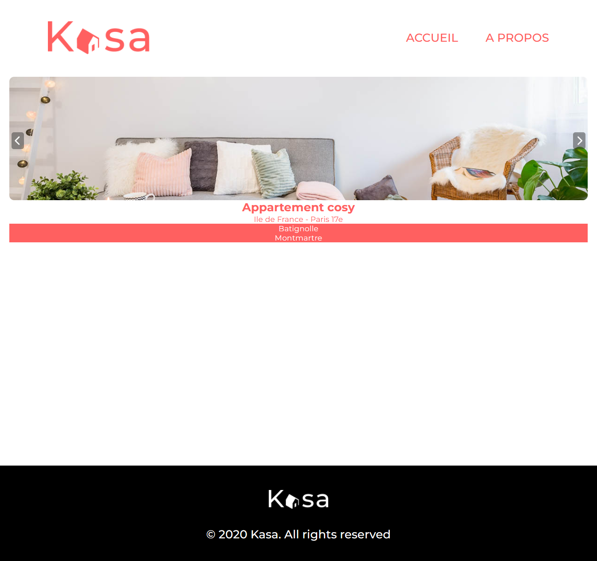

# 🏠 Kasa


## 📖 Overview

Kasa is a React application for browsing lodging listings and viewing detailed property information.

The project was originally based on an existing JavaScript application before being fully refactored to TypeScript in order to improve code quality, maintainability, and data safety.

The refactor focused on:

- Full JavaScript → TypeScript migration
- Strict typing implementation
- Improved code readability
- Better component maintainability
- Safer data handling
- Cleaner project structure

---

## 🧰 Tech Stack

- React
- Create React App
- TypeScript
- React Router
- CSS3

---

## 🚀 Quick Start

Install dependencies:

```bash
yarn
```

Run the development server:

```bash
yarn start
```

The application runs on:

```bash
http://localhost:3000
```

---

## 🏗️ Project Structure

```bash
src/
│
├── assets/
├── components/
├── contexts/
├── models/
├── pages/
├── services/
│
├── App.tsx
├── index.tsx
├── index.css
└── react-app-env.d.ts
```

### Structure Overview

- assets/ – Static assets and images
- components/ – Reusable UI components
- contexts/ – React contexts and shared state
- models/ – TypeScript interfaces and data models
- pages/ – Main application pages
- services/ – Application services and utilities
- App.tsx – Root application component
- index.tsx – Application entry point
- index.css – Global application styles
- react-app-env.d.ts – TypeScript environment declarations

---

## 🔗 Application Features

Users can:

- Browse lodging listings
- Access lodging detail pages
- View lodging information and galleries
- Navigate through different pages
- Access error pages for invalid routes

Routing is handled with React Router to provide smooth client-side navigation.

---

## 🔄 TypeScript Refactor

The main goal of the project was to migrate an existing JavaScript codebase to TypeScript.

The refactor included:

- Converting React components from `.jsx` to `.tsx`
- Adding interfaces and custom types
- Typing component props
- Securing application data structures
- Improving IDE autocomplete and developer experience
- Reducing potential runtime errors

This migration improved both maintainability and scalability of the project.

---

## 🎨 Frontend Architecture

The application is structured around reusable React components and a modular folder organization.

The project is separated into:

- Reusable UI components
- Application pages
- Shared state management with Context API
- TypeScript models and interfaces
- Service and utility layers

This structure improves readability, maintainability, and scalability while making the TypeScript migration easier to
manage.

---

## ⚡ Performance & Maintainability

- Reusable component architecture
- Strong TypeScript typing
- Clear folder organization
- Centralized routing
- Improved code readability

---

## 📸 Screenshots

<table style="border: none;">
  <tr style="border: none;">
    <td align="center" style="border: none;">
      <strong>Homepage</strong><br><br>
      
    </td>
    <td align="center" style="border: none;">
      <strong>Accommodation Details</strong><br><br>
      
    </td>
  </tr>
</table>

---

## 📊 Project Status

The project is complete and is no longer actively developed.

---

## 📝 Notes

This project was built as a TypeScript refactor exercise focused on improving an existing React application.

The goal was to practice:

- TypeScript migration
- Strict typing
- Component refactoring
- Frontend architecture
- Code maintainability
- Scalable React project organization

The project emphasizes clean and maintainable frontend development practices.
